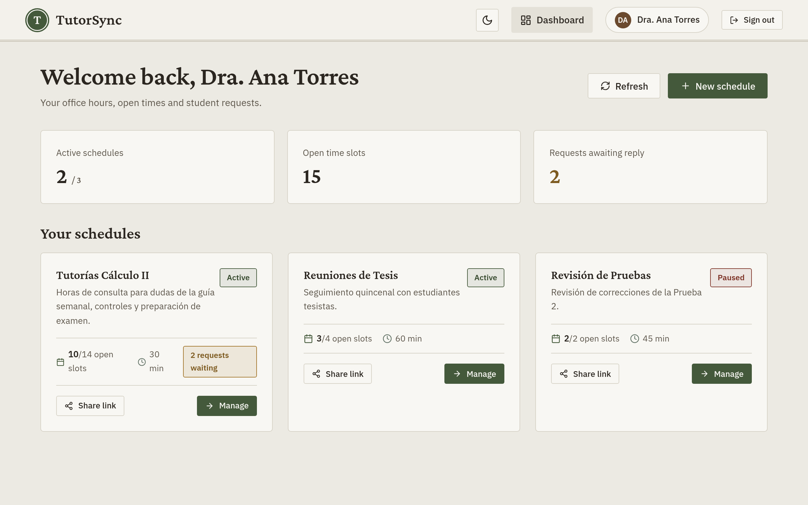
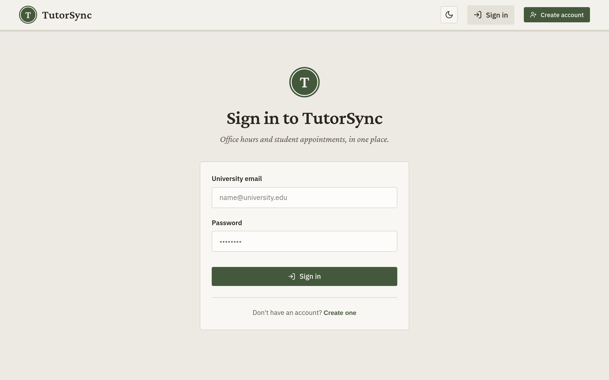
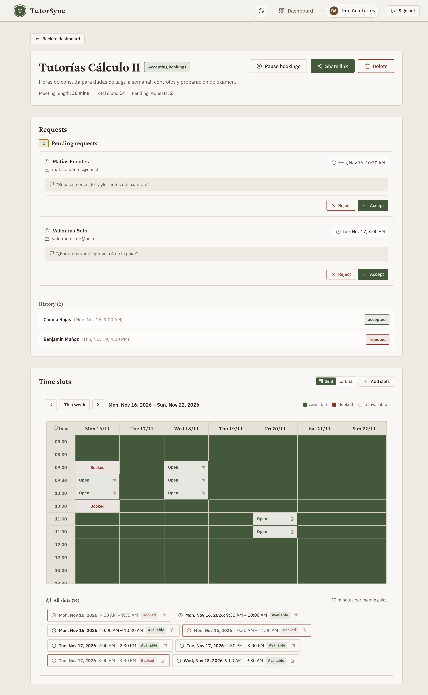
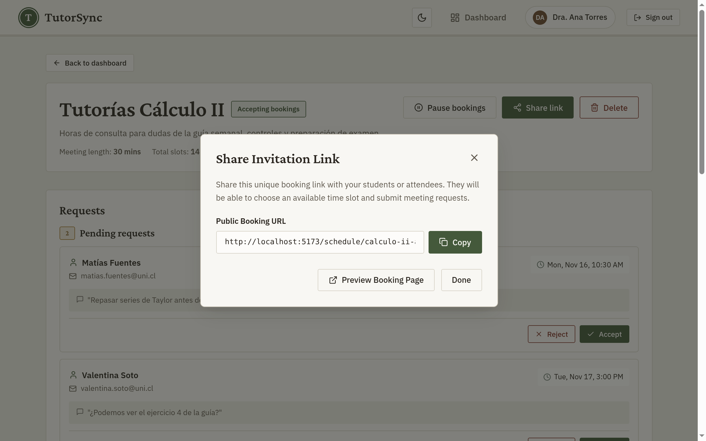
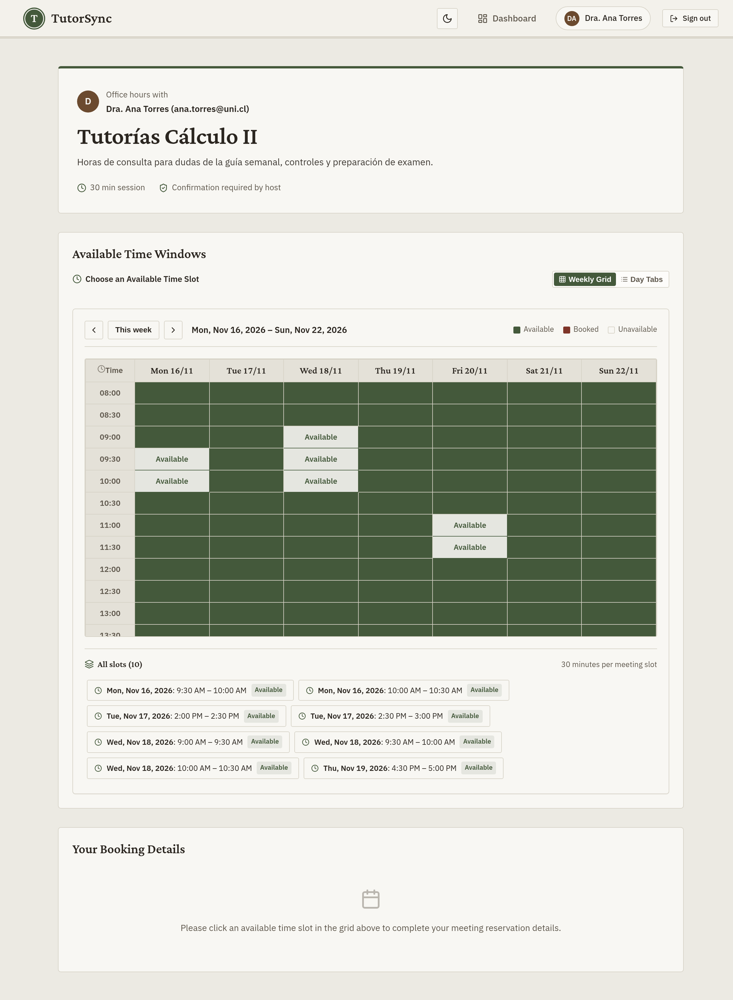
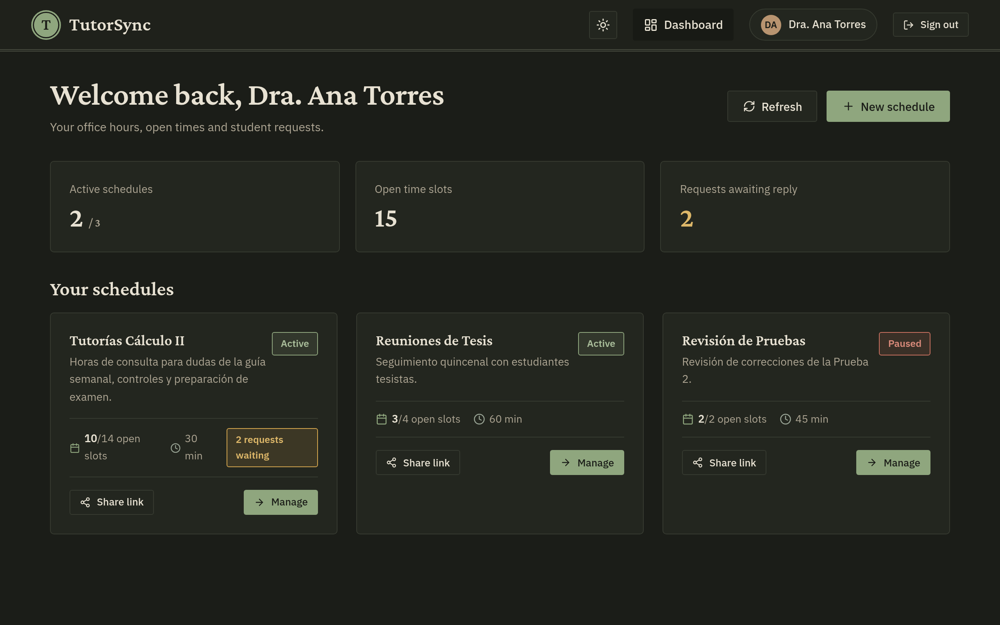

# TutorSync · Meeting Scheduler

Agendador de horas de consulta y tutorías universitarias. Un docente o tutor crea un horario con bloques disponibles, comparte un enlace público y los estudiantes reservan un bloque. El dueño del horario acepta o rechaza cada solicitud desde su panel.



## Funcionalidades

- **Autenticación con email y contraseña** (JWT).
- **Horarios**: crea espacios de agenda con título, descripción y duración por reunión (30, 45, 60 min…).
- **Bloques de tiempo** editables en una grilla semanal o en lista.
- **Enlace público para compartir**: cualquiera con el link puede ver los bloques libres y pedir una reunión.
- **Gestión de solicitudes**: aceptar, rechazar e historial de reservas.
- **Pausar horarios** para dejar de recibir reservas sin borrarlos.
- **Tema claro / oscuro**.

## Capturas

### Inicio de sesión



### Detalle del horario: solicitudes y grilla semanal

El dueño ve las solicitudes pendientes con la nota del estudiante, el historial y la grilla de bloques (disponibles / reservados).



### Compartir enlace de invitación



### Página pública de reserva

Lo que ve el estudiante al abrir el enlace: solo los bloques libres y futuros.



### Modo oscuro



## Flujo

```text
Docente                                  Estudiante
───────                                  ──────────
1. Inicia sesión
2. Crea un horario + bloques
3. Comparte /schedule/:linkToken  ─────▶ 4. Abre el enlace y elige un bloque
                                         5. Envía la solicitud (nombre, email, nota)
6. Acepta o rechaza  ◀───────────────────
```

## Stack

| Capa | Tecnologías |
| --- | --- |
| Frontend | React 18, Vite, React Router, lucide-react |
| Backend | Node.js, Express, TypeScript |
| Base de datos | PostgreSQL + Sequelize |
| Auth | JWT + bcryptjs |
| Deploy | Vercel (backend serverless) |

## Estructura

```text
meeting-scheduler/
├── backend/            API REST (Express + TypeScript)
│   └── src/
│       ├── config/     conexión a la base de datos
│       ├── models/     User, Schedule, TimeSlot, Booking
│       ├── controllers/
│       ├── services/   lógica de negocio
│       ├── routes/     /auth, /schedules, /bookings, /users
│       └── middlewares/
└── frontend/           SPA en React (Vite)
    └── src/
        ├── pages/      Login, Dashboard, ScheduleDetail, PublicBooking, Profile
        ├── components/ booking/, schedule/, common/
        ├── context/    Auth, Schedule, Theme
        └── services/   cliente de la API
```

## Cómo correrlo localmente

Requisitos: Node.js 18+ y una base PostgreSQL (local o, por ejemplo, Neon).

### 1. Backend

```bash
cd backend
npm install
cp .env.example .env   # completa DATABASE_URL (o DB_*) y JWT_SECRET
npm run db:sync        # crea las tablas
npm run dev            # http://localhost:5001/api
```

### 2. Frontend

```bash
cd frontend
npm install
npm run dev            # http://localhost:5173
```

En desarrollo, Vite redirige `/api` a `http://localhost:5001`. Para apuntar a otro backend define `VITE_API_URL` en `frontend/.env` (ver `.env.example`).

## API

Base: `/api`

| Método | Ruta | Descripción |
| --- | --- | --- |
| `GET` | `/health` | Estado del servicio |
| `POST` | `/auth/register` | Registro |
| `POST` | `/auth/login` | Inicio de sesión |
| `GET` | `/auth/me` | Usuario actual |
| `GET` | `/schedules/my-schedules` | Horarios del usuario |
| `POST` | `/schedules` | Crear horario |
| `GET` / `PUT` / `DELETE` | `/schedules/:id` | Ver, editar o borrar un horario |
| `POST` | `/schedules/:id/slots` | Agregar bloques |
| `DELETE` | `/schedules/slots/:slotId` | Borrar un bloque |
| `GET` | `/schedules/public/:linkToken` | Horario público (bloques libres) |
| `POST` | `/bookings` | Solicitar una reunión |
| `GET` | `/bookings/schedule/:scheduleId` | Solicitudes de un horario |
| `PATCH` | `/bookings/:id/status` | Aceptar / rechazar |
| `PATCH` | `/bookings/:id/cancel` | Cancelar una reserva |
| `GET` | `/bookings/my-bookings` | Reservas del usuario |
| `GET` / `PUT` | `/users/profile` | Perfil |

## Tests

```bash
cd backend && npm test
cd frontend && npm test
```
